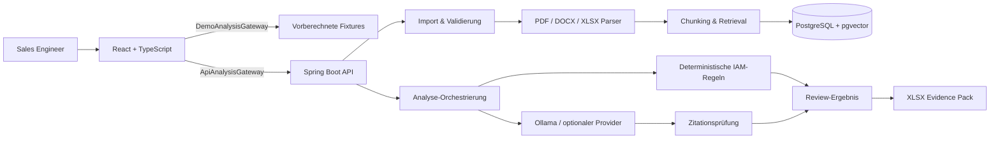

# EvidenceRFP

> **Portfolio-Demo · vollständig synthetische Daten**
>
> EvidenceRFP ist kein Produkt der fiktiven Unternehmen CertaAccess oder Nordstern Bank. Die öffentliche Demo verarbeitet keine Uploads und keine echten Kundendaten.

**Vom Security-Fragebogen zur belegbaren Antwort – inklusive IAM-Kontrollnachweisen.**

EvidenceRFP unterstützt Technical-Sales-Teams dabei, wiederkehrende Security-Fragebögen schneller und belastbarer zu beantworten. Die Anwendung findet passende Aussagen in freigegebenen Produktunterlagen, zeigt die exakte Fundstelle, markiert Widersprüche und ergänzt dokumentbasierte Antworten um deterministische Identity-Security-Prüfungen.


*Echter Screenshot der laufenden React-Anwendung; alle sichtbaren Namen, Dokumente und Ergebnisse sind synthetisch.*

## Der 60-Sekunden-Scan

| Recruiter-Frage | Antwort |
|---|---|
| Welches Problem wird gelöst? | RFP-Antworten sind langsam, schwer prüfbar und anfällig für unbelegte Aussagen. |
| Für wen? | Sales Engineers, Presales Consultants, Security- und IAM-Teams. |
| Was ist technisch interessant? | Dokument-Retrieval, serverseitig validierte Zitationen, kontrollierte Human-in-the-loop-Freigabe und regelbasierte IAM-Checks. |
| Wo liegt der Geschäftswert? | Weniger Rechercheaufwand, kürzere Antwortzeiten und ein nachvollziehbarer Audit-Trail. |
| Was macht die Demo glaubwürdig? | Jede Antwort ist `SUPPORTED`, `PARTIAL` oder `NOT_FOUND`; fehlende Evidenz wird nie erfunden. |
| Was kann ich sofort ansehen? | Die statische GitHub-Pages-Demo nutzt vorberechnete, klar gekennzeichnete Ergebnisse – ohne Backend und ohne Upload. |

## Warum dieses Projekt?

Identity Security verbindet technische Tiefe mit einem klaren Presales-Prozess: Anforderungen verstehen, Risiken sichtbar machen, einen PoC abgrenzen und Nutzen nachvollziehbar erklären. Die Projektauswahl orientiert sich an öffentlich zugänglichen Einblicken von [ENISA](https://www.enisa.europa.eu/sites/default/files/2026-02/NIS%20Investments%202025%20-%20Main%20report.pdf) und [ISC2](https://www.isc2.org/Insights/2025/12/2025-ISC2-Cybersecurity-Workforce-Study) sowie an realen Rollenprofilen bei [EY](https://careers.ey.com/ey/job/Berlin-Berater-IAM-Cyber-Security-%28wmd%29-BE-10117/1193467201/) und [Palo Alto Networks](https://jobs.paloaltonetworks.com/en/job/munich/domain-consultant-solution-engineer/47263/101871697968). Die verlinkten Organisationen stehen in keiner Verbindung zu EvidenceRFP.

## Vier Minuten Demo-Story

1. **Import:** Ein Security-Fragebogen der fiktiven Nordstern Bank wird geladen.
2. **Analyse:** Fünf synthetische CertaAccess-Dokumente werden durchsucht; ein IAM-Snapshot durchläuft drei reproduzierbare Kontrollen.
3. **Review:** Eine belegte Antwort öffnet die genaue Quellpassage. Ein Widerspruch wird nebeneinander angezeigt. Eine unbeantwortbare Frage erzeugt eine interne Klärungsfrage.
4. **Entscheidung:** Der Sales Engineer korrigiert und genehmigt Antworten. Konflikte bleiben bis zur Klärung gesperrt.
5. **Übergabe:** Der geprüfte Stand wird als Excel Evidence Pack exportiert.

Der vollständige Moderationstext steht im [Demo Talk Track](docs/DEMO_TALK_TRACK.md).

## Kernfunktionen

- Import eines RFP im XLSX-Format (`ID`, `Question`, optional `Category`)
- Verarbeitung textbasierter PDF- und DOCX-Produktunterlagen
- Antworten mit prüfbaren Dokument-, Abschnitts- und Chunk-Zitationen
- Antwortstatus `SUPPORTED`, `PARTIAL` und `NOT_FOUND` statt erfundener Prozentwerte
- Erkennung fehlender, widersprüchlicher oder veralteter Evidenz
- Deterministische Kontrollen für privilegierte Konten, verwaiste Konten und alte Service-Account-Zugangsdaten
- Bearbeitungs- und Freigabe-Workflow mit sicherem XLSX-Export
- Zwei Frontend-Modi mit demselben Datenmodell: statische Demo-Fixtures oder lokale API
- Geführter lokaler Importdialog für XLSX, mehrere PDF/DOCX-Dateien und einen optionalen IAM-Snapshot

## Architektur



**Vertrauensgrenze:** Uploads und Dokumenttexte sind nicht vertrauenswürdig. Nur das Backend validiert Dateityp, Retrieval-Kontext, Zitationen, Statusübergänge und Exportdaten. Das Modell besitzt keine Tools und darf keine Aktionen ausführen. Mehr dazu im [Threat Model](docs/THREAT_MODEL.md).

## Technologie

- Java 21, Spring Boot 4.1.x, Spring AI 2.0.x
- React, TypeScript, Vite
- PostgreSQL, Flyway, pgvector
- Apache POI sowie PDF-/Tika-Reader
- deterministischer Offline-Modus ohne KI-Schlüssel
- Ollama mit `llama3.1:8b` und `bge-m3` als lokale KI-Voreinstellung
- optionaler, bewusst zu aktivierender OpenAI-Adapter mit eigenem API-Key
- JUnit, Testcontainers, Vitest, Testing Library und Playwright

## Quickstart: öffentliche Demo lokal ansehen

Voraussetzungen: Node.js 22+ und npm.

```bash
cd frontend
npm ci
npm run dev
```

Die Frontend-Voreinstellung nutzt synthetische Demo-Fixtures. Falls nötig:

```bash
VITE_APP_MODE=demo npm run dev
```

Unter PowerShell lautet die letzte Zeile:

```powershell
$env:VITE_APP_MODE = "demo"
npm run dev
```

## Quickstart: vollständiger lokaler Stack

Voraussetzungen: Java 21, Node.js 22+, Docker Desktop und optional eine lokale Ollama-Installation.

1. Konfiguration anlegen und Datenbank starten:

   ```bash
   cp .env.example .env
   docker compose up -d postgres
   ```

2. Lokale Modelle bereitstellen – entweder mit installiertem Ollama:

   ```bash
   ollama pull llama3.1:8b
   ollama pull bge-m3
   ```

   oder per Docker-Profil:

   ```bash
   docker compose --profile ai up -d ollama
   docker compose exec ollama ollama pull llama3.1:8b
   docker compose exec ollama ollama pull bge-m3
   ```

3. Backend starten:

   ```bash
   cd backend
   ./mvnw -Pproduction,ollama spring-boot:run -Dspring-boot.run.profiles=production,ollama
   ```

   Unter Windows: `mvnw.cmd -Pproduction,ollama spring-boot:run "-Dspring-boot.run.profiles=production,ollama"`. Falls kein Maven Wrapper vorhanden ist, lässt sich derselbe Aufruf mit `mvn` ausführen. Die eingecheckten Entwicklungswerte sind ausschließlich für localhost gedacht; geänderte Werte aus `.env` müssen auch als Prozessvariablen des Backends gesetzt werden.

   Ohne Sprachmodell kann das Backend reproduzierbar mit `-Pproduction` und dem Profil `production` gestartet werden. Dann verwendet es den regelbasierten Antwortgenerator und deterministische 1.024-dimensionale Hash-Embeddings. Mit `production,ollama` stammen Chat-Antworten von `llama3.1:8b` und Embeddings tatsächlich von `bge-m3`.

4. Frontend in einem zweiten Terminal mit API-Modus starten:

   ```bash
   cd frontend
   npm ci
   VITE_APP_MODE=api VITE_API_BASE_URL=http://localhost:8080 npm run dev
   ```

5. In der Oberfläche **Neue Analyse** wählen und die erzeugten Beispieldaten hochladen. Die Binär-Fixtures lassen sich reproduzierbar aus den lesbaren Quellen erzeugen; der Ablauf steht in [scripts/README.md](scripts/README.md).

Die Anwendung ist anschließend unter `http://localhost:5173` erreichbar; die API unter `http://localhost:8080/api/v1`.

### Optionaler Cloud-Provider

Nur wenn eine externe Verarbeitung ausdrücklich gewollt ist, kann statt Ollama der mitgelieferte OpenAI-Adapter aktiviert werden:

```bash
export OPENAI_API_KEY="..."
cd backend
./mvnw -Pproduction,openai spring-boot:run -Dspring-boot.run.profiles=production,openai
```

In diesem Modus verlassen Dokumentpassagen die lokale Umgebung. Für reale Kundendaten ist der MVP ausdrücklich nicht freigegeben; siehe [Security und Grenzen](docs/SECURITY_LIMITATIONS.md).

## API auf einen Blick

| Methode | Pfad | Zweck |
|---|---|---|
| `GET` | `/api/v1/capabilities` | Laufzeitfähigkeiten und aktivierter KI-Provider |
| `POST` | `/api/v1/analyses` | RFP, Evidenzdateien und optionalen IAM-Snapshot einreichen |
| `GET` | `/api/v1/analyses/{id}` | Fortschritt und Verarbeitungsstatus abrufen |
| `GET` | `/api/v1/analyses/{id}/result` | Fragen, Antworten, Zitationen und Findings laden |
| `PATCH` | `/api/v1/analyses/{id}/questions/{questionId}` | Antwort bearbeiten oder freigeben |
| `GET` | `/api/v1/analyses/{id}/export.xlsx` | Geprüftes Evidence Pack exportieren |
| `DELETE` | `/api/v1/analyses/{id}` | Analyse und zugehörige lokale Daten löschen |

Der aktuelle MVP verarbeitet einen Import innerhalb des `POST`-Requests und liefert danach `COMPLETED`. Die Status-Ressource ist bereits vorhanden, damit ein späterer Job-Runner ohne Änderung am Frontend ergänzt werden kann.

## Portfolio-Unterlagen

- [Architekturentscheidungen](docs/ARCHITECTURE.md)
- [Threat Model](docs/THREAT_MODEL.md)
- [Discovery Brief](docs/DISCOVERY_BRIEF.md)
- [ROI Case](docs/ROI_CASE.md)
- [PoC Success Plan](docs/POC_SUCCESS_PLAN.md)
- [Einwandbehandlung](docs/OBJECTION_HANDLING.md)
- [Security und Grenzen](docs/SECURITY_LIMITATIONS.md)
- [Demo Talk Track](docs/DEMO_TALK_TRACK.md)
- [Beispieldaten und erwartete Ergebnisse](examples/README.md)

## Qualitätsziele

- Gemessener Offline-Recall@6: **94,1 % (16/17)** beantwortbare Golden-Set-Fragen; die CI-Untergrenze liegt bei 90 %.
- 100 % ausgegebener Zitationen zeigen auf einen tatsächlich abgerufenen Chunk und ein darin enthaltenes Zitat.
- Unbeantwortbare Fragen bleiben `NOT_FOUND`; Konflikte und veraltete Evidenz verhindern automatische Freigaben.
- Positive und negative IAM-Fixtures decken jede Kontrollregel ab.

## Bewusste Grenzen

Kein Login, keine Mandantenfähigkeit, kein OCR, keine echte IdP- oder CRM-Verbindung, keine automatische Kontosperrung und keine rechtliche Compliance-Bewertung. Die Anwendung ist ein Portfolio-MVP und verarbeitet ausschließlich synthetische Daten. Details und sichere Betriebsannahmen stehen in [Security und Grenzen](docs/SECURITY_LIMITATIONS.md).

## Mitwirken

Beiträge sind willkommen. Bitte zuerst [CONTRIBUTING.md](CONTRIBUTING.md) und [SECURITY.md](SECURITY.md) lesen.

## Lizenz

[MIT](LICENSE) · © 2026 EvidenceRFP Contributors
