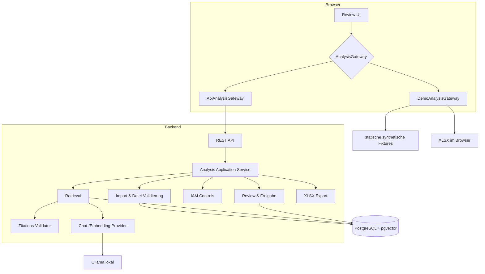

# Architektur

## Zielbild

EvidenceRFP ist ein modularer Monolith. Fachlogik, Sicherheitsgrenzen und Datenhaltung bleiben im Spring-Boot-Backend; das React-Frontend kennt ausschließlich das gemeinsame Gateway-Datenmodell. Das erleichtert eine eindrucksvolle öffentliche Demo, ohne Upload- oder KI-Funktionen ins Internet zu stellen.

## Module und Verantwortlichkeiten

| Modul | Verantwortlichkeit | Nicht verantwortlich für |
|---|---|---|
| Import | Dateiformat, MIME/Magic Bytes, Größenlimit, Parserauswahl | Fachliche Bewertung |
| Evidence | Normalisierung, Chunking, Metadaten, Retrieval | Freigabe von Antworten |
| Analysis | Orchestrierung, strukturierte Antwortentwürfe | Autoritative Security-Entscheidungen |
| Citation | Chunk-Zugehörigkeit und wörtliche Fundstelle prüfen | Neue Belege erzeugen |
| IAM Controls | Drei deterministische Regeln auf Snapshot-Daten | Änderungen am IdP |
| Review | Editieren, Konfliktsperre, Human-in-the-loop-Freigabe und append-only Ereignisprotokoll | Automatische Genehmigung bei Konflikten |
| Export | Formula-Injection-sicheres XLSX Evidence Pack | Originaldateien verändern |

## Datenfluss

1. Ein Upload wird vor dem Parsen anhand Erweiterung, deklariertem MIME-Type, Magic Bytes und Größenlimit geprüft.
2. Nach synchroner Upload-Validierung erhält der Client eine Analyse-ID; die Verarbeitung läuft in einer begrenzten lokalen Worker-Queue. Der Browser verfolgt den Lauf über die Status-Ressource.
3. Text wird normalisiert, mit Dokument- und Abschnittsmetadaten in Chunks zerlegt und einmal pro Analyse eingebettet. Im Offline-Production-Profil entstehen deterministische Hash-Vektoren; mit `ollama` liefert `bge-m3` semantische 1.024-dimensionale Embeddings.
4. Je Frage werden aus demselben kurzlebigen Index höchstens sechs relevante Chunks abgerufen und als nicht vertrauenswürdiger Kontext an das Modell übergeben.
5. Das Modell liefert ein strukturiertes Ergebnis. Der Server akzeptiert nur bekannte Statuswerte und Zitationen auf abgerufene Chunks.
6. Eine Zitation ist nur gültig, wenn der normalisierte Zitatausschnitt im referenzierten Chunk enthalten ist.
7. Der IAM-Snapshot wird getrennt davon durch deterministische Regeln verarbeitet.
8. Konflikte, veraltete Quellen und fehlende Belege werden modellunabhängig als Findings gespeichert und beeinflussen den Freigabestatus.
9. Vollständige extrahierte Quellenpassagen werden unabhängig vom kurzlebigen Retrieval-Index für die menschliche Nachprüfung gespeichert.
10. Jede Bearbeitung oder Reviewentscheidung erzeugt ein append-only Ereignis mit Provenienz, Vorher-/Nachher-Werten und Zeitstempel.
11. Der Export wird erst freigegeben, wenn jede Frage bewusst freigegeben oder als Klärung blockiert wurde.

## Frontend-Modi

`DemoAnalysisGateway` lädt vorberechnete Ergebnisse, hält lokale Reviewänderungen ausschließlich im Browser und kann sie auf den definierten Ausgangszustand zurücksetzen. Es besitzt keine Upload-Funktion und sendet keine Daten an einen Server. Das synthetische XLSX Evidence Pack wird ebenfalls im Browser erzeugt. `ApiAnalysisGateway` spricht mit der lokalen REST-API. Beide implementieren dasselbe Interface, sodass UI und Demo-Story identisch bleiben.

Die Auswahl erfolgt beim Build über `VITE_APP_MODE=demo|api`. Für GitHub Pages wird ausschließlich `demo` verwendet.

## Entscheidungsprotokoll

- **Modularer Monolith statt Microservices:** weniger Betriebsaufwand, aber klare Fachgrenzen.
- **PostgreSQL plus pgvector:** Transaktions- und Vektordaten bleiben konsistent in einem System.
- **Profilabhängige Embeddings:** Offline-Hashing hält den Stack ohne Modell lauffähig; `production,ollama` ersetzt es über denselben Port durch `bge-m3`.
- **Deterministische IAM-Regeln:** Findings sind reproduzierbar und nicht vom Sprachmodell abhängig.
- **Lokales Ollama als Default:** keine Dokumentübertragung an einen Cloud-Provider.
- **Begrenzter lokaler Job-Runner:** Der POST-Request validiert und puffert Uploads, gibt eine ID zurück und übergibt die Verarbeitung an einen kleinen Thread-Pool. Status-Polling hält lange Ollama-Läufe aus dem Request-Lifecycle heraus.
- **Keine numerische KI-Konfidenz:** Status und überprüfbare Evidenz sind erklärbarer als scheinpräzise Scores.

Im `production`-Profil werden Analysen, Fragen, Review-Status, Findings, Dokumentmetadaten, vollständige Quellenpassagen und Reviewereignisse relational in PostgreSQL gespeichert. Retrieval-Chunks werden einmal pro Analyse in einen isolierten pgvector-Arbeitsindex geschrieben, für alle Fragen wiederverwendet und anschließend entfernt. Die Reviewpassagen bleiben davon getrennt erhalten, damit Zitationen nach Abschluss weiterhin auf den vollständigen Kontext zeigen. Das Demo-Profil verwendet absichtlich ein In-Memory-Repository.

## Laufzeitannahmen

- Eine Instanz, eine lokale Datenbank, keine Mandantentrennung.
- Analyse-Daten gelten als temporär und können über den DELETE-Endpunkt entfernt werden.
- Alle Beispiele sind synthetisch. Für reale Daten fehlen im MVP unter anderem Authentifizierung, Autorisierung, Mandantenisolation und eine belastbare Aufbewahrungsrichtlinie.
