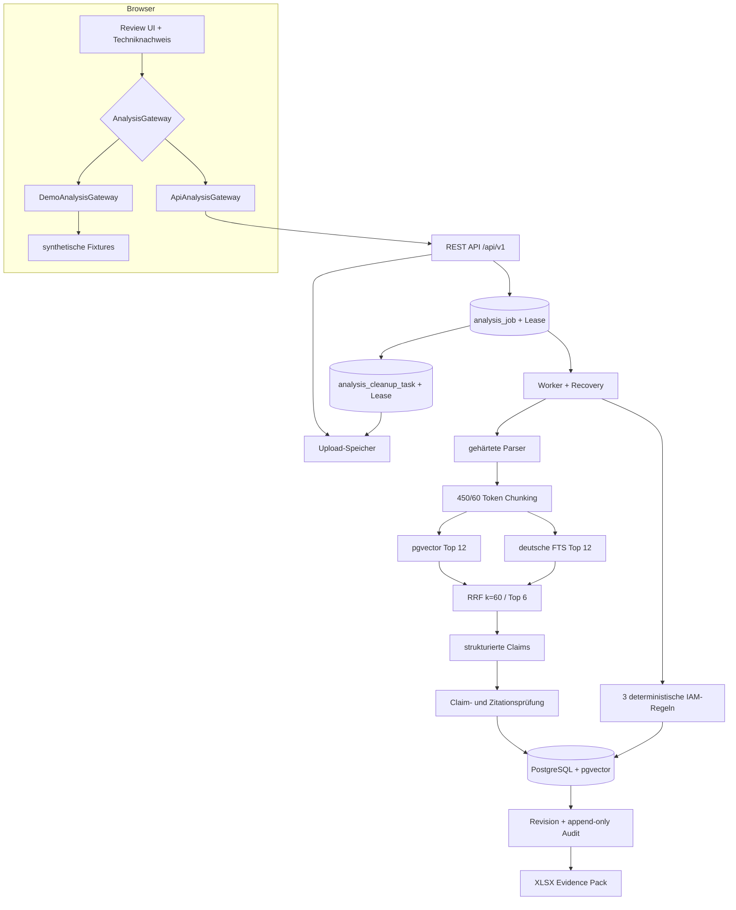

# Architektur

## Zielbild

EvidenceRFP 0.2 ist ein modularer Monolith. Fachlogik, Sicherheitsgrenzen, Jobsteuerung und
Datenhaltung liegen im Spring-Boot-Backend. Das React-Frontend verwendet einen stabilen,
versionierten API-Vertrag; die öffentliche GitHub-Pages-Demo ersetzt ausschließlich das Gateway
durch synthetische Fixtures.

## Persistenter Jobablauf

1. Der Request wird gegen Anzahl, Einzel- und Gesamtgröße, Endung, MIME-Type und Magic Bytes
   geprüft. Ein optionaler `Idempotency-Key` wird zusammen mit dem Request-Hash registriert.
2. Akzeptierte Dateien erhalten servergenerierte Namen und werden außerhalb des Webrequests
   gespeichert. Analyse, Job und Uploadmetadaten entstehen in einer Transaktion.
3. Worker sperren einen Kandidaten mit `FOR UPDATE SKIP LOCKED`, übernehmen ihn atomar und
   erhalten eine Lease von 30 Sekunden. Ein Heartbeat verlängert sie alle zehn Sekunden.
4. Persistierte Phasen sind `QUEUED`, `PARSING`, `INDEXING`, `ANSWERING`, `IAM_CHECKS`,
   `PERSISTING`, `COMPLETED`, `FAILED` und `CANCELLED`.
5. Nach einem Prozessabbruch wird der gesamte Lauf idempotent neu begonnen. Nach dem zweiten
   abgelaufenen Versuch endet er mit `JOB_RETRIES_EXHAUSTED`.
6. Nur der aktuelle Lease-Besitzer kann per Compare-and-Set aus `PROCESSING` finalisieren.
   DELETE bricht Job und Analyse atomar ab; ein alter Worker kann die Analyse nicht neu anlegen.
7. Erfolg, Fehler und Abbruch legen in derselben Datenbanktransaktion einen dauerhaften
   Cleanup-Auftrag an. Ein Cleanup-Worker löscht die Rohdateien und entfernt erst danach die
   Uploadmetadaten. Sein eigener Lease kann nach einem Absturz übernommen werden; fehlgeschlagene
   Löschungen bleiben mit sicherem Fehlercode und erneutem Ausführungszeitpunkt erhalten.
8. Ein zusätzlicher, lazy lesender Sweeper entfernt UUID-Verzeichnisse, die seit mindestens einer Stunde keine
   zugehörige Analyse und keinen offenen Cleanup-Auftrag mehr besitzen. Das deckt einen Absturz
   zwischen Dateispeicherung und Jobregistrierung ab. Teilergebnisse eines Analyseversuchs werden
   nie als fertiges Ergebnis verwendet.

## Dokument- und Retrieval-Pipeline

PDF ist auf 200 Seiten begrenzt. Pro Datei gelten außerdem eine Million extrahierte Zeichen und
2.000 Chunks. OOXML darf dekomprimiert höchstens 100 MB, 2.000 ZIP-Einträge und ein Verhältnis
von 100:1 erreichen. Ein Bulkhead lässt höchstens vier Parser gleichzeitig und acht weitere in
der Queue zu; der Aufrufer bricht das Warten nach 20 Sekunden ab. Der JVM-Interrupt ist für
nicht-kooperativen Bibliothekscode nur Best Effort, weshalb eine harte Abbruchgarantie einen
separaten Sandbox-Prozess erfordert. DOCX/XLSX werden über ihre verpflichtenden
OOXML-Bestandteile erkannt; Makros, OLE, externe Beziehungen, Verschlüsselung, doppelte Einträge
und Pfad-Traversal führen zu einer kontrollierten Ablehnung. Persistierte PDFs und XLSX-Dateien
werden über den erneut validierten Storage-Pfad statt über eine vollständige Heap-Kopie geöffnet;
das PDF-Zeichenbudget wird bereits während der seitweisen Textextraktion erzwungen.

Chunks orientieren sich an Abschnitten und Sätzen, sind höchstens 450 Tokens lang und überlappen
um 60 Tokens. Ihre UUID wird deterministisch aus Dokumenthash, Fundstelle und normalisiertem
Inhalt abgeleitet. Embeddings entstehen in Batches von 32 und werden außerhalb lang laufender
Datenbanktransaktionen berechnet.

Im Production-Profil liefert pgvector zwölf Dense-Kandidaten und PostgreSQL mit deutscher
Sprachkonfiguration zwölf lexikalische Kandidaten. Reciprocal Rank Fusion mit `k = 60` erzeugt
die finalen sechs Chunks. Gespeichert werden Kanal, Einzelrang, Fusionsscore, Chunk-Hash,
Retrievalversion und Embeddingmodell. Das sind Provenienzdaten, keine KI-Konfidenz.

Das Modell liefert einzelne Claims mit Chunk-Referenzen. Der Server prüft erlaubte Chunk-ID,
wörtliches Zitat, Zahlen, zentrale Entitäten und Negationen. Vollständig belegte Claims ergeben
`SUPPORTED`, eine belegte Teilmenge `PARTIAL` und kein belegter Claim `NOT_FOUND`. Provider- oder
Schemafehler beenden die Analyse technisch und werden nie zu `NOT_FOUND` umgedeutet.

Die Adapter besitzen ein hartes Budget von höchstens zwei Wiederholungen für Timeouts,
HTTP 429 und 5xx. Spring AIs eigene Retry-Schicht ist mit `spring.ai.retry.max-attempts: 0`
bewusst deaktiviert, damit sich beide Ebenen nicht multiplizieren.

## Konsistenz und API-Vertrag

- Vollständige Analyse-, Status- und Exportansichten werden als `REPEATABLE_READ`-Snapshot geladen.
- Jede Frage besitzt eine Revision. PATCH verlangt `If-Match`; ohne Header folgt 428, bei einer
  alten Revision 412 `EDIT_CONFLICT`.
- Frage und Audit-Ereignis mit Vorher-/Nachher-Werten und Provenienz werden in derselben
  Transaktion gespeichert.
- `/result`, Review und Export sind vor `COMPLETED` mit 409 `ANALYSIS_NOT_READY` gesperrt.
- RFC-7807-Antworten enthalten sichere Fehlercodes, aber keine Parser- oder Providerdetails.
- Der Vertrag liegt unter [`openapi/evidence-rfp-v1.yaml`](openapi/evidence-rfp-v1.yaml); der
  TypeScript-Client wird in CI daraus neu generiert und auf Drift geprüft. Zusätzlich ruft
  `OpenApiContractTest` die von Springdoc aus den realen Controllern und DTOs erzeugte
  `/v3/api-docs`-Ausgabe ab. Routen, Methoden, Operation-IDs, Parameter, Request Bodies,
  Statuscodes, Header, Medientypen sowie rekursiv aufgelöste Schemaformen mit Pflichtfeldern und
  dokumentierten Constraints müssen dem versionierten Vertrag entsprechen; der Backend-CI-Job
  prüft ausdrücklich, dass dieses Gate ausgeführt wurde.

## Betriebsnachweis

Micrometer misst Parser, Chunking, Embedding, Retrieval, Generierung, Verifikation und Export.
Zähler erfassen Antwortstatus, verworfene Zitationen, Parserablehnungen und Fehlercodes; Gauges
zeigen aktive Worker und Queue. Strukturierte Logs enthalten Korrelations-, Analyse-, Frage- und
Phasenkennung, aber keine Dokumenttexte. Ein Webserver-Customizer erzwingt für alle Backendprofile
`127.0.0.1`, auch wenn eine externe Konfiguration eine andere Adresse vorgibt.

## Profile und Grenzen

`demo` verwendet ein In-Memory-Repository und deterministische Fixtures. `production` aktiviert
PostgreSQL, Flyway und pgvector. `ollama` ergänzt lokal `llama3.1:8b` und `bge-m3`; `openai` ist
ein bewusster Cloud-Opt-in. Authentifizierung, Mandantenisolation, OCR, echter IdP und CRM bleiben
außerhalb von 0.2. Alle öffentlich sichtbaren Daten sind synthetisch.

Die Entscheidungen sind zusätzlich in [ADR 0001](adr/0001-durable-analysis-jobs.md) und
[ADR 0002](adr/0002-hybrid-retrieval.md) festgehalten.
