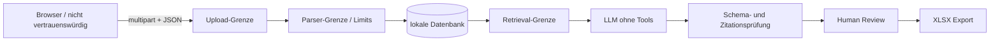

# Threat Model

Stand: 18. Oktober 2026 · Gültig für EvidenceRFP 0.2 mit ausschließlich synthetischen Daten.

## Schutzgüter und Vertrauensgrenzen

Schutzgüter sind hochgeladene Dokumente, extrahierte Texte, Embeddings, generierte Antworten, IAM-Snapshots und freigegebene Exporte. Als nicht vertrauenswürdig gelten Browser-Eingaben, Dateinamen, Dateiinhalt, Dokumentmetadaten, IAM-JSON sowie jede Modellausgabe.

## Bedrohungen und Kontrollen

| Bedrohung | Auswirkung | MVP-Kontrolle | Restrisiko |
|---|---|---|---|
| Datei tarnt sich über Endung oder MIME-Type | Parser-Angriff, unerwarteter Inhalt | Allowlist, MIME- und Magic-Byte-Abgleich, Größen- und Dateianzahllimit | Schwachstelle in Parserbibliothek |
| ZIP-Bombe in DOCX/XLSX | Speicher-/CPU-Erschöpfung | 100 MB entpackt, 100:1, 2.000 Einträge, Duplikat-/Traversalprüfung und 20-Sekunden-Parserbudget | Parser- oder Betriebssystemschwachstelle; kein Sandboxprozess |
| Aktiver Inhalt in OOXML | Makroausführung, externe Datenabfrage oder eingebettete Payload | verpflichtende OOXML-Bestandteile; Makros, OLE, externe Beziehungen und verschlüsselte Pakete werden abgelehnt | neue oder unbekannte OOXML-Konstrukte |
| Viele parallele Analysejobs | Arbeitsspeicher-/Worker-Erschöpfung | persistente Queue, begrenzte Worker, Dateibudgets, Leases und maximale Versuche | keine Benutzerquoten oder Rate Limits |
| Pfadmanipulation über Dateinamen | Überschreiben lokaler Dateien | Servergenerierte IDs; Originalname nur als bereinigte Metadaten | Fehlerhafte Drittbibliothek |
| Prompt Injection im Dokument | Modell folgt Dokumentanweisung | Dokument als untrusted context; Systeminstruktion; keine Tools; keine Seiteneffekte | Manipulierter Antwortentwurf |
| Halluzinierte Zitation oder gegenteiliger Claim | Falscher Nachweis | erlaubte Chunk-ID, exaktes Zitat, Zahlen, zentrale Entitäten und Negationen werden geprüft | semantisch irreführende, aber formal passende Passage |
| Manipulierte oder übergroße Modellausgabe | Parserlast oder eingeschleuste Felder | exaktes Claim-Schema, Feld- und Listenlimits sowie 600.000-Zeichen-Gesamtlimit | formal gültige, aber fachlich irreführende Ausgabe |
| Prozessabbruch während Analyse | dauerhaft hängender oder doppelt finalisierter Job | Lease/Heartbeat, vollständiger idempotenter Neustart, höchstens zwei Versuche und CAS-Finalisierung | lokale Rohdatei geht durch externen Datenträgerfehler verloren |
| Gelöschte Analyse wird durch alten Worker neu angelegt | unerwartete Datenwiederkehr | atomarer Abbruch und Finalisierung ausschließlich aus `PROCESSING` durch aktuellen Lease-Besitzer | Administrator manipuliert Datenbank direkt |
| Parallele Reviewänderungen überschreiben sich | verlorene Freigabe oder Auditlücke | Fragenrevision, `If-Match`, 412 und Audit-Ereignis in derselben Transaktion | keine Benutzeridentität im MVP |
| Datenabfluss an KI-Provider | Vertrauliche Inhalte verlassen System | Ollama lokal als Default; Cloud nur explizit mit eigenem Schlüssel | Fehlkonfiguration bei Cloud-Nutzung |
| XLSX Formula Injection | Code/Link wird beim Öffnen ausgeführt | Zellen mit `=`, `+`, `-` oder `@` werden als Text escaped | Verhalten exotischer Office-Clients |
| Unbefugte Freigabe | Ungeprüfte Antwort wird exportiert | Explizite Review-Zustände; Konflikte blockieren Freigabe | MVP hat keine Benutzeridentität |
| Mandantenübergriff | Daten anderer Kunden sichtbar | Im MVP nicht adressiert; nur lokale synthetische Einzelnutzung | Kritisch bei produktiver Nutzung |
| Veraltete Evidenz | Falsche Zusage im Angebot | Gültigkeitsdatum/Version anzeigen; Finding und Freigabesperre | Falsche Metadaten in Quelle |
| Manipulierter IAM-Snapshot | Falsche Findings | typisierte JSON-Deserialisierung und deterministische Regeln | Quelle und Vollständigkeit des Snapshots werden nicht attestiert |

## Missbrauchsfälle

### Dokument verlangt die Offenlegung des Systemprompts

Der Text bleibt reiner Retrieval-Kontext. Das Modell bekommt keine Secrets, Tools oder frei wählbaren URLs. Die Ausgabe wird strukturell und gegen die tatsächlich abgerufenen Chunks validiert.

### Angreifer lädt eine ausführbare Datei als PDF hoch

Endung, deklarierter MIME-Type und Signatur müssen zueinander passen. Nur unterstützte Textformate werden geparst. Dateien werden nie ausgeführt.

### Modell erfindet eine überzeugende Antwort

Ohne gültige, serverseitig geprüfte Zitation darf der Status nicht `SUPPORTED` sein. Fehlt Evidenz, lautet der Status `NOT_FOUND` und es wird eine interne Klärungsfrage angelegt.

## Nicht abgedeckt

Der MVP besitzt keine Authentifizierung, Rollen, Mandantenisolation, Verschlüsselungsverwaltung, Malware-Sandbox, DLP, Hochverfügbarkeit oder produktive Überwachung. Daher ist er nicht für echte Kundendaten freigegeben. Vor einem Produktivbetrieb sind mindestens AuthN/AuthZ, Mandantengrenzen, Secret Management, Verschlüsselung, Aufbewahrungs- und Löschkonzept, Malware-Prüfung, Audit Logging und ein unabhängiger Security-Test erforderlich.

## Automatisierte Verifikation im Repository

- Negative Uploadtests für MIME-/Magic-Byte-Abweichung, Pfadmanipulation und Übergröße
- Unit-Tests, dass fremde Chunk-IDs und nicht enthaltene Zitate verworfen werden
- Exporttest für alle vier Formula-Injection-Präfixe
- Tests, dass Konflikte die Freigabe verhindern und Negativfragen `NOT_FOUND` bleiben
- 80-Fälle-Golden-Set mit Gates für Recall@6, MRR, Status-Macro-F1, Pflichtbegriffe, Zitationen und `NOT_FOUND`
- Testcontainers-Tests für zwei Worker, Lease-Recovery, Löschrennen, optimistische Reviews und Hybrid Retrieval
- positive und negative Fixtures für alle drei IAM-Regeln

Vor einer produktiven Nutzung fehlen insbesondere Malware-Scanning beziehungsweise Parser-Sandboxing und modellübergreifendes Prompt-Injection-Red-Teaming.

## Referenzen

- [OWASP File Upload Cheat Sheet](https://cheatsheetseries.owasp.org/cheatsheets/File_Upload_Cheat_Sheet.html)
- [OWASP GenAI: Prompt Injection](https://genai.owasp.org/llmrisk/llm01-prompt-injection/)

Die Referenzen liefern Sicherheitsleitlinien; sie sind keine Zertifizierung oder Bestätigung dieses Projekts durch OWASP.
